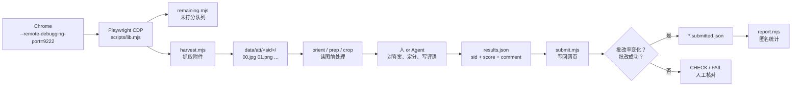

# ykt-grader · 雨课堂网页作业批改工具箱

> 把"助教在雨课堂网页上一份份看作业、写评语、录分数"这件事，拆成**可复用的流程 + 可核验的脚本**。
> 面向教师 / 助教 / 教学团队，也面向愿意读流程、自己动手的 AI Agent。

[](LICENSE)
[](package.json)
[](requirements.txt)
[](https://playwright.dev/)


---

## 这是什么

`ykt-grader` 是一个**半自动**的批改工具箱，由三层组成：

| 层 | 内容 | 解决什么 |
|---|---|---|
| 知识层 | [`SKILL.md`](SKILL.md) + [`docs/`](docs/) | 网页怎么走、每份作业怎么读、分数怎么定、坑在哪 |
| 工具层 | [`scripts/`](scripts/) | 抓附件、切页放大、写评语与分数、核验保存、生成统计 |
| 记录层 | `data/`（本地、不入库） | 谁改了、改成几分、依据是什么，可回溯、可复核 |

它**不是**刷分器，也不绕过任何登录：

- 不保存账号密码，不存储 Cookie，不调用雨课堂私有接口；
- 浏览器就是你自己的 Chrome，登录态由你维护；
- 分数由人（或 Agent 按你给的规则）判断，脚本只负责"搬附件、填内容、核验结果"；
- 每一步都留下可核对的日志，出问题能定位到具体学生和具体操作。

## 为什么需要它

雨课堂的主观题批改页对"批量"并不友好：

- 一份作业可能是**图片、PDF、内嵌画布**三种形态之一，抓取方式各不相同；
- "极速打分"模式下，点分数字就是提交，而且会**自动跳到下一位**——连续盲点极易串人；
- 分数按钮是文本匹配，`:has-text("9")` 会同时命中 `9` 和 `9.5`；
- 一个主观题里往往塞着六七道教材习题，只看第一页就判分必然误判。

这些东西写成文字是"注意事项"，写成脚本才是"不会忘的检查"。本项目就是那次真实批改（167 份、7–10 分档）之后，把流程和代码一起沉淀下来的结果。

## 特性

- **只连本机 Chrome**：Playwright 通过 CDP 连接 `127.0.0.1:9222`，不接管、不新建浏览器配置，登录状态与书签都不受影响。
- **三种附件统一抓取**：图片原图、PDF 画布、正文内嵌图，落到 `data/att/<sid>/` 并按页编号，清单写入 `manifest.json`。
- **精确写分**：优先在"得分"输入框键入分值再回车，绕开按钮子串匹配；找不到输入框才退回 `满分 / 9.5 / 9` 按钮。
- **写前写后双检**：写之前核对当前选中学生的网页标识，写之后核对"批改成功"提示与批改率变化，两者都不符就记为 `CHECK` 而不是假装成功。
- **断点续跑**：`manifest.json` 记录已抓取，`*.submitted.json` 记录已提交；中断后重跑自动跳过，不会重复打分。
- **读图工具链**：`orient.py` 判断旋转、`prep.py` 切半页、`crop2.py` 放大细节、`pdfrender.py` 渲染 PDF。
- **隐私默认**：`data/`、`results*.json`、`*.submitted.json` 全部在 `.gitignore` 里；`report.mjs` 默认只输出匿名聚合。
- **Agent 友好**：`SKILL.md` 就是一份可直接投喂给 Claude Code / Codex / DeepSeek Harness 的技能说明，入口清晰、约束明确。

## 工作流



一张可以离线打开的流程图见 [`assets/workflow.html`](assets/workflow.html)。

## 目录结构

```
ykt-grader/
├── SKILL.md                    # Agent 入口：先读这个
├── AGENTS.md                   # 仓库协作约定（给 Agent 的短说明）
├── README.md
├── LICENSE
├── package.json                # Node 脚本入口与依赖
├── requirements.txt            # Python 依赖（Pillow / PyMuPDF）
├── assets/
│   └── workflow.html           # 离线可开的流程图
├── config/
│   └── exam.example.json       # 课程/作业配置模板（复制后填自己的）
├── docs/
│   ├── setup.md                # 环境准备与 Chrome 调试端口
│   ├── workflow.md             # 完整批改流程（人工 + 自动）
│   ├── grading.md              # 评分档、评语写法、匿名案例
│   ├── answers-ch6.md          # 第六章核对表与答案勘误（示例）
│   ├── automation.md           # 脚本逐个说明与退出码
│   ├── architecture.md         # 设计取舍与已知失效点
│   ├── privacy.md              # 脱敏清单与数据规范
│   └── faq.md                  # 常见故障排查
├── examples/
│   ├── results.example.json    # 写回格式示例（虚构学生）
│   ├── rubric.example.md       # 单次作业的评分规则模板
│   └── record.example.json     # 批次记录模板
└── scripts/
    ├── lib.mjs                 # CDP 连接与页面读取
    ├── status.mjs              # 标签页/页面诊断
    ├── remaining.mjs           # 未打分队列
    ├── roster.mjs              # 已打分花名册 + 分布
    ├── harvest.mjs             # 批量抓附件
    ├── grab.mjs                # 单个学生附件
    ├── dlpdf.mjs               # 下载原文件
    ├── pdfinfo.mjs             # 作答区结构诊断
    ├── submit.mjs              # 评语 + 分数写回
    ├── verify.mjs              # 读回核验
    ├── fixscores.mjs           # 批量改分
    ├── report.mjs              # 匿名统计
    └── python/
        ├── orient.py           # 方向拼版
        ├── prep.py             # 旋转 / 缩放 / 切半页
        ├── crop2.py            # 局部放大
        └── pdfrender.py        # PDF → PNG
```

## 快速开始

### 0. 前置条件

- Windows / macOS / Linux，装有 Chrome 或 Edge；
- Node.js ≥ 18，Python ≥ 3.10；
- 你对目标课程有**批改权限**，并愿意为自己的操作负责。

### 1. 启动一个带调试端口的 Chrome

用独立配置目录，避免和日常浏览器互相干扰（首次打开需要重新登录雨课堂）：

```powershell
# Windows PowerShell
& "$env:ProgramFiles\Google\Chrome\Application\chrome.exe" `
  --remote-debugging-port=9222 `
  --user-data-dir="$env:TEMP\ykt-chrome"
```

```bash
# macOS
"/Applications/Google Chrome.app/Contents/MacOS/Google Chrome" \
  --remote-debugging-port=9222 --user-data-dir=/tmp/ykt-chrome

# Linux
google-chrome --remote-debugging-port=9222 --user-data-dir=/tmp/ykt-chrome
```

> 端口被占用时换一个，并用 `YKT_CDP_URL` 告诉脚本。

### 2. 在这个 Chrome 里登录并打开批改页

登录雨课堂 → 进入课程 → 作业 → **去批改**。确认页面左侧能看到学生列表。

### 3. 安装依赖

```bash
npm install
pip install -r requirements.txt
```

### 4. 自检

```bash
npm run status        # 应列出标签页，并打印批改页正文开头
npm run remaining     # 应打印批改率与未打分名单
```

看到 `批改率: x / y` 就说明链路通了。

## 一次批改怎么跑

下面以"抓 8 份 → 读完 → 写回"为例。

```bash
# 1. 看还剩多少人
npm run remaining -- --limit 10

# 2. 抓接下来 8 份附件（自动跳过已抓过的）
node scripts/harvest.mjs 8

# 3. 对每个学生做读图前处理（以 data/att/<sid> 为例）
python scripts/python/orient.py data/att/105000001
python scripts/python/prep.py data/att/105000001 --rot 270 --split --montage
python scripts/python/crop2.py data/att/105000001 00 0.05 0.05 0.95 0.45 --out top

# 4. 人/Agent 逐份阅读并产出 results.json
#    格式见 examples/results.example.json

# 5. 写回网页（逐条核验，失败会记录原因）
node scripts/submit.mjs data/results.json

# 6. 抽查读回
node scripts/verify.mjs 105000001 105000002
```

`results.json` 长这样：

```json
[
  {
    "name": "示例学生A",
    "sid": "105000001",
    "score": 9.5,
    "comment": "思维导图与习题齐全，6.62(b) 请补齐 i1(t)、i2(t) 的最终表达式与单位，其余主要结果正确。"
  }
]
```

字段说明：

| 字段 | 必填 | 说明 |
|---|---|---|
| `sid` | 是 | 批改页姓名下方的**网页学生标识**，不是学校学号 |
| `name` | 建议 | 仅用于日志可读性；写回时以 `sid` 为准 |
| `score` | 是 | 0–10，允许 0.5 档 |
| `comment` | 是 | 会被原样填入评语框；建议 120–300 字、指出具体题号与正确值 |

## 评分规则

本项目的评分档来自一次真实课程的**用户偏好**，不是雨课堂或学校的通用标准。换课程、换老师时请重写 [`docs/grading.md`](docs/grading.md)，并给每次作业单独准备 `rubric.md`。

| 可验证的作业情况 | 建议分 |
|---|---:|
| 完整且主要解答正确 | 10 |
| 1 道题有实质错误或明显未完成 | 9.5 |
| 2 道题有实质错误或明显未完成 | 9 |
| 更多题出错，或缺少思维导图 | 8 |
| 大量缺答、只有导图、或提交内容不属于本次作业 | 7 |

要点：

- 按**题**计错，同一道题的连带错误算 1 题；
- 字迹工整、排版规范可加 0.5，上限 10；
- 只给波形没写表达式、单位不规范属于小瑕疵，写进评语而不是降档；
- 不因为"参考答案可疑"就判学生错——先核对题纸参数。

## 配置

脚本通过环境变量定位浏览器和数据，不把路径写死在代码里：

| 变量 | 默认值 | 说明 |
|---|---|---|
| `YKT_CDP_URL` | `http://127.0.0.1:9222` | Chrome 远程调试地址 |
| `YKT_DATA_DIR` | `./data` | 附件、清单、日志的根目录 |

课程信息（课程名、作业名、题号列表）建议写进 `config/exam.json`（从 [`config/exam.example.json`](config/exam.example.json) 复制），供 Agent 和 `rubric.md` 引用。**不要把 classroom_id / exam_id 这类内部链接提交到公开仓库。**

## 安全与隐私

这个仓库在公开前做过一次系统性脱敏，**不含**：

- Chrome 用户目录、Cookie、历史记录、登录态；
- 任何学生作业原件、附件、截图；
- 学生姓名、网页学生标识、学校学号、分数明细；
- 课程/班级/考试的内部 ID 与教师个人链接；
- 本机绝对路径、Windows 用户名、WSL 路径、教师姓名；
- 教材答案原文（仅保留公开可核对的结论表与勘误）。

规则是：**学生数据只留在 `data/`，而 `data/` 永不入库**。细节与自查清单见 [`docs/privacy.md`](docs/privacy.md)。

## 已知限制

- 依赖页面 DOM（`.student-item`、`.anwser`、`.score-panel` 等），雨课堂改版后需要重新对照 `scripts/pdfinfo.mjs` 的输出调整选择器；
- 写回是 UI 自动化，不是官方 API；是否允许、允许到什么程度，请遵守学校规定与平台条款；
- 只在 Chromium 内核浏览器上验证过，Firefox / Safari 不适用；
- 不处理加密、损坏或超大附件；
- 不替你做学术判断：**分数错了，责任在使用者**。

## 文档

| 文档 | 内容 |
|---|---|
| [SKILL.md](SKILL.md) | Agent 技能入口（先读这个） |
| [docs/setup.md](docs/setup.md) | 环境、Chrome 调试、依赖安装 |
| [docs/workflow.md](docs/workflow.md) | 从进课程到核验保存的完整流程 |
| [docs/grading.md](docs/grading.md) | 评分档、评语规范、匿名案例 |
| [docs/answers-ch6.md](docs/answers-ch6.md) | 第六章核对表与答案勘误（示例） |
| [docs/automation.md](docs/automation.md) | 每个脚本的参数、输出与失败处理 |
| [docs/architecture.md](docs/architecture.md) | 组件关系、关键取舍、失效模式 |
| [docs/privacy.md](docs/privacy.md) | 脱敏清单与数据规范 |
| [docs/faq.md](docs/faq.md) | 常见故障与处理 |

## 许可与使用边界

MIT License，见 [LICENSE](LICENSE)。

请只在**你有权限批改的课程**上使用，并遵守学校教务规定与雨课堂服务条款。因误用造成的成绩错误、数据泄露或账号风险，由使用者自行承担。
